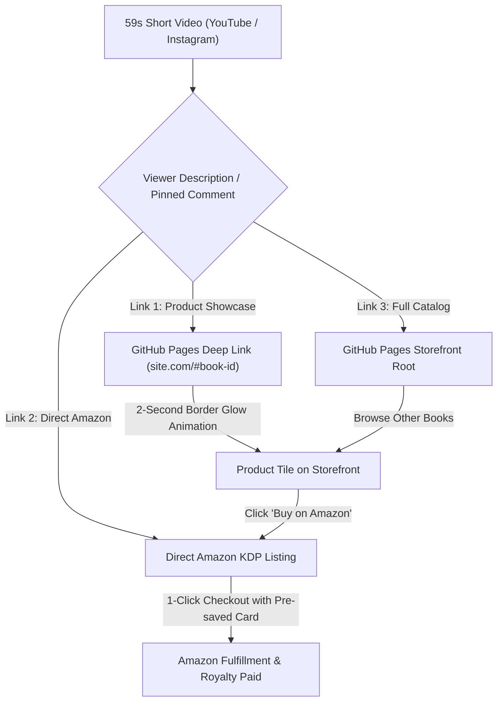

# "TheBookGuy" Brand & Automated Funnel Specification

*Brand Name*: **TheBookGuy**  
*Platform*: YouTube Shorts / Instagram Reels + GitHub Pages Showcase + Amazon KDP  
*Strategy*: Physical Books First $\to$ High-Utility Products $\to$ Audience Pool $\to$ Creative Dream Journals

---

## 1. Funnel Architecture



---

## 2. Technical Mechanics

### 2.1 Deep Linking & Glow Animation
- URL Format: `https://<username>.github.io/?item=lucid-dream-journal` (or `/#lucid-dream-journal`)
- Javascript detects the URL parameter/hash on page load.
- Automatically smooth-scrolls the viewport directly to that book's tile.
- Adds an active CSS class `.highlight-glow` that pulsates an electric cyan/amber outline for exactly 2 seconds, then smoothly returns to default.
- Prominent `{ Buy on Amazon -> }` button inside the tile redirects directly to the Amazon ASIN/URL.

### 2.2 The 3-Link Description Standard (Every Video)
```text
📖 [Book Title] — Available Now in Paperback!
👉 Buy this Book: https://<username>.github.io/?item=<slug>
📦 Direct Amazon Link: https://amazon.com/dp/<ASIN>
🏛️ Explore the Full Library: https://<username>.github.io/

#books #thebookguy #journal #productivity #reading
```

---

## 3. The 10% Discount Reality on Amazon KDP

> [!IMPORTANT]
> **How Amazon KDP Handles Discounts**:
> Unlike Shopify, Amazon KDP **does not** support custom promo codes (e.g. typing "SAVE10" at checkout) for self-published paperbacks. 
> 
> **How to implement the 24-hr discount effectively**:
> 1. **Launch Discount Pricing**: List the book at the normal price (e.g., $11.99), but run a 24–48 hour launch price of $9.99 directly on KDP metadata.
> 2. **Storefront Visual Badge**: On your GitHub storefront tile, display:
>    - `Special Launch Price: $9.99` ~~(Regular $11.99)~~ `[Expires in 24 Hours]`
> 3. **Amazon Native Coupons**: Amazon occasionally allows enrolled authors or sellers to clip a digital coupon (5%–10% off) directly on the Amazon product page.

---

## 4. Video Production Format: The Strict 59-Second Rule

Every video on "TheBookGuy" follows an identical 59-second storyboard:

| Second Range | Focus | What Happens |
| :--- | :--- | :--- |
| **0:00 – 0:05** | The Hook & Problem | Close-up hands holding the physical book or opening to a striking page. Clear verbal hook addressing a pain point. |
| **0:05 – 0:25** | The Mechanism / Inside Pages | Fast flip-through of interior pages (e.g., how the sleep tracker works, or why the layout solves a problem). |
| **0:25 – 0:45** | The Practical Benefit | Why this physical book beats digital notes or apps (focus, tactile feel, no phone screen distractions). |
| **0:45 – 0:59** | Call-to-Action | Show the front/back cover. *"Grab your copy in paperback via the pinned comment or check out the full library at TheBookGuy."*
